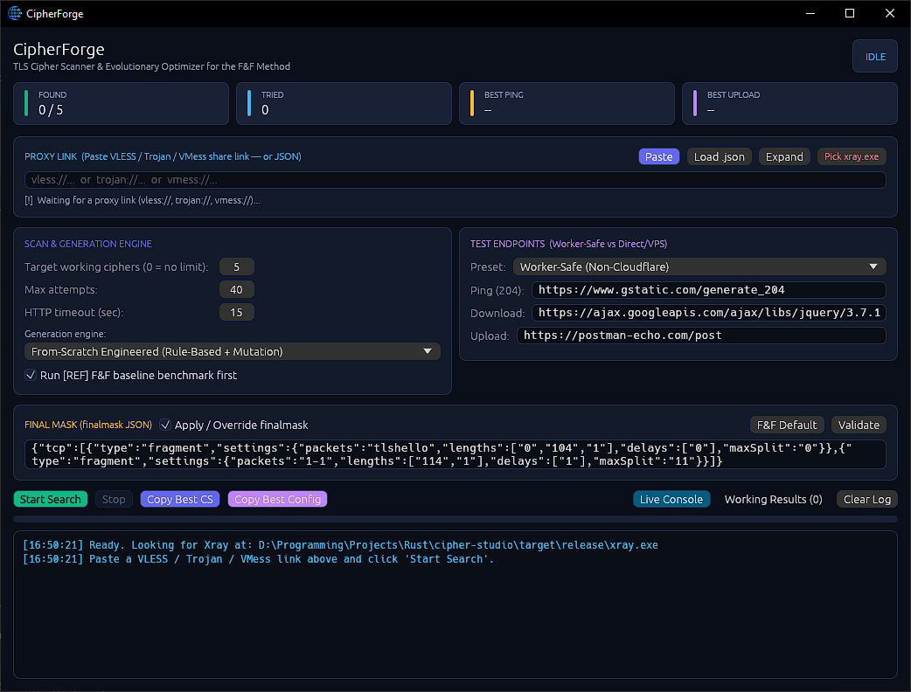

  
  <h1>CipherForge</h1>
  
<strong>اسکنر و بهینه‌ساز هوشمند TLS Cipher Suites برای متد F&amp;F (فرگمنت + اثرانگشت)</strong>

  

    <a href="README.md">English</a> •
    <a href="README.fa.md">فارسی</a>
  

---

## معرفی

**CipherForge** یک ابزار دسکتاپ پرتابل و سریع به زبان **Rust** برای ساخت، اسکن و بنچمارک **TLS Cipher Suites (`cs`)** مخصوص متد **F&F** است.

برخلاف تسترهای پینگ ساده، این برنامه هر ترکیب را از طریق یک تونل ایزوله Xray با تست واقعی **پینگ (Ping)**، **سرعت دانلود** و **سرعت آپلود (POST)** بررسی می‌کند تا مواردی که دست‌دهی انجام می‌دهند ولی آپلودشان روی `0 KB/s` قفل می‌شود بلافاصله حذف شوند.

  

---

## ویژگی‌های کلیدی

- **بدون نیاز به فایل JSON پایه:** لینک‌های عادی **`vless://`**، **`trojan://`** و **`vmess://`** (یا کانفیگ JSON) را مستقیم داخل برنامه Paste کنید.
- **موتور مهندسی از صفر + جهش هوشمند (Evolutionary Mutation):**
  - تولید ساختاریافته Cipherها بر اساس قوانین لایه‌بندی TLS (`TLS 1.3` ← `ECDHE AEAD` ← `دنباله استتار`) با سوگیری‌های مختلف (`256-bit`، `128-bit`، `ChaCha20`) و چیدمان‌های استاندارد.
  - جهش خودکار روی بهترین ترکیب‌های موفق برای پیدا کردن نسخه‌های کم‌پینگ‌تر و پرسرعت‌تر متناسب با اینترنت شما.
- **قالب‌های استاندارد متنوع:** پشتیبانی از قالب‌های `Semi-Python`، `Chrome-Like`، `Firefox-Like`، `Mobile-AEAD`، `Schannel` و حالت ترکیبی `Hybrid`.
- **تست واقعی دانلود و آپلود:** بدون نیاز به `curl.exe` خارجی (با هسته بومی `reqwest` و `rustls`).
- **پروفیل آدرس‌های تست (مخصوص Worker و VPS):** سوییچ سریع بین آدرس‌های غیرکلادفلری (مناسب برای Workerها) و آدرس‌های کلادفلر.
- **ویرایشگر `finalmask` (`fm`):** امکان ویرایش، فعال/غیرفعال‌سازی و اعتبارسنجی JSON فرگمنت.
- **کپی کامل کانفیگ F&F با یک کلیک:** خروجی گرفتن از رشته `cs` یا کل لینک کانفیگ کدگذاری‌شده (`fp=unsafe&cs=...&fm=...`) آماده برای ایمپورت در کلاینت.

---

## راهنمای سریع اجرا (نسخه پرتابل ویندوز)

1. آخرین نسخه را از بخش [**Releases**](https://github.com/NetForgeDev/CipherForge/releases) دانلود و از حالت فشرده خارج کنید.
2. مطمئن شوید فایل **`xray.exe`** (از مخزن [`patterniha/Xray-core`](https://github.com/patterniha/Xray-core/releases) که از آرایه‌های `lengths`/`delays` در `finalmask` پشتیبانی می‌کند) در **کنار `CipherForge.exe`** قرار دارد (یا با دکمه `Pick xray.exe` داخل برنامه مسیرش را بدهید).
3. برنامه **`CipherForge.exe`** را اجرا کنید *(قبل از اسکن، VPN سیستم را خاموش کنید)*.
4. لینک سرور را Paste کرده، پروفیل تست را انتخاب کنید و **Start Search** را بزنید.
5. در تب **Working Results** نتایج را بر اساس بهترین پینگ یا سرعت مرتب کنید و با **Copy Config** یا **Copy CS** کپی بگیرید.

نتایج سالم به صورت خودکار در فایل `working_ciphers.txt` هم ذخیره می‌شوند.

