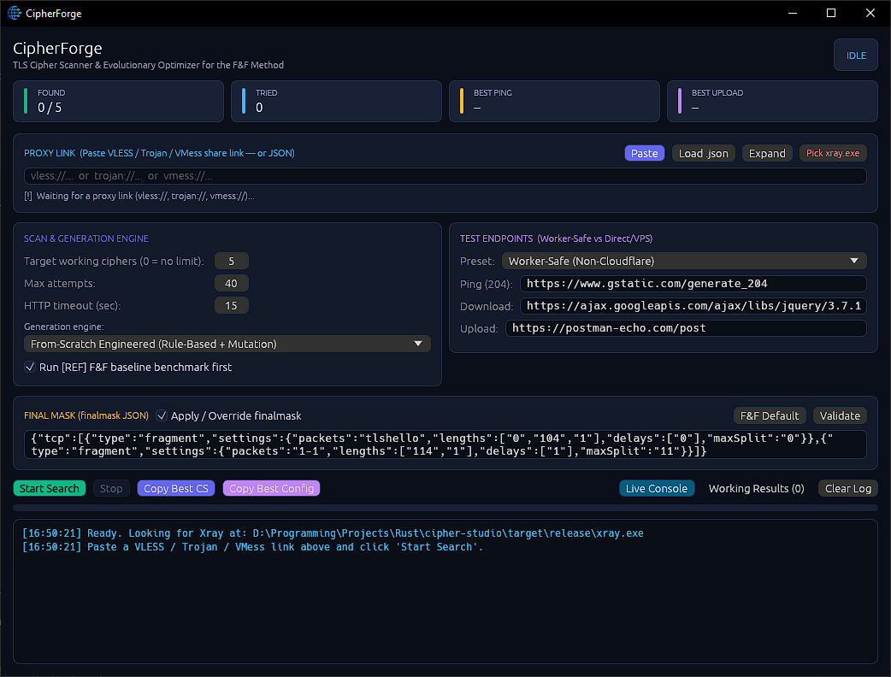

<div align="center">
  
  <h1>CipherForge</h1>
  <p><strong>TLS Cipher Suite Scanner &amp; Evolutionary Optimizer for the F&amp;F (Fragment + Fingerprint) Method</strong></p>

  <p>
    <a href="README.md">English</a> •
    <a href="README.fa.md">فارسی (Persian)</a>
  </p>

  <p>
    
    
    
  </p>
</div>

---

## Overview

**CipherForge** is a lightweight, portable desktop tool built in pure Rust for scanning, generating, and benchmarking custom **TLS Cipher Suites (`cs`)** tailored for the **F&F (Fragment + Fingerprint)** anti-censorship method.

Unlike simple ping checkers, CipherForge routes real **HTTP Latency**, **Download**, and **POST Upload** probes through an isolated Xray SOCKS5 tunnel—immediately filtering out cipher suites that handshake successfully but suffer from upload throttling (`0 KB/s` upload drops).

<!-- Uncomment or keep this once you upload assets/preview.png -->
<p align="center">
  
</p>

---

## Key Features

- **No Base JSON Required:** Paste standard **`vless://`**, **`trojan://`**, **`vmess://`** share links (or raw Xray JSON) directly into the UI.
- **From-Scratch Engineered Generator + Evolutionary Mutation:**
  - Synthesizes valid, tier-ordered TLS cipher lists (`TLS 1.3` → `ECDHE AEAD` → `Camouflage Tail`) across multiple cryptographic biases (`256-bit`, `128-bit`, `ChaCha20`) and stack groupings (`Cipher-First`, `Auth-First`, `RSA-First`).
  - Automatically **mutates** top-performing passing suites to discover lower-latency and higher-upload variants tailored to your ISP.
- **Standard Client Templates:** Includes `Semi-Python`, `Chrome-Like`, `Firefox-Like`, `Mobile Pure-AEAD`, and `Windows Schannel` profiles, plus a `Hybrid` mode.
- **Real End-to-End Verification:** Measures Ping (`204`), Download speed, and real Upload speed via native `reqwest` + `rustls` (no external `curl` needed).
- **Worker-Safe & Direct Endpoint Presets:** Switch easily between non-Cloudflare test endpoints (safe for Cloudflare Workers) and direct Cloudflare endpoints, or enter custom URLs.
- **Live `finalmask` (`fm`) Editor:** Edit, validate, or toggle custom multi-stage fragment masks directly inside the app.
- **One-Click F&F Config Export:** Copy either the raw `cs` string or a complete, RFC-3986 URL-encoded share link (`fp=unsafe&cs=...&fm=...`) ready to import into your proxy client.
- **Portable Single-Binary UI:** Built with `eframe`/`egui`—runs without installation.

---

## Quick Start (Portable Windows Release)

1. Download the latest release ZIP from the [**Releases**](https://github.com/<YOUR_USERNAME>/CipherForge/releases) page and extract it.
2. Make sure **`xray.exe`** (from [`patterniha/Xray-core`](https://github.com/patterniha/Xray-core/releases), which supports multi-array `finalmask` `lengths`/`delays`) is in the **same folder** as `CipherForge.exe` (or select it using the `Pick xray.exe` button inside the app).
3. Run **`CipherForge.exe`**. *(Make sure any system VPN is turned off while scanning.)*
4. Paste your `vless://`, `trojan://`, or `vmess://` link, choose your endpoint preset (`Worker-Safe` for Cloudflare Workers), and click **Start Search**.
5. Switch to the **Working Results** tab to sort by **Best Ping / Upload / Download** and click **Copy Config** or **Copy CS**.

Results are also automatically saved to `working_ciphers.txt`.

---

## Building from Source

### Prerequisites
- [Rust toolchain](https://rustup.rs/) (`stable`)
- Windows: Visual Studio Build Tools (*Desktop development with C++*)

```bash
git clone https://github.com/<YOUR_USERNAME>/CipherForge.git
cd CipherForge
cargo build --release
```

The portable executable will be generated at `target/release/CipherForge.exe`.

---

## Disclaimer

This tool is intended strictly for network diagnostics, TLS fingerprint research, and authorized security/connectivity testing.
